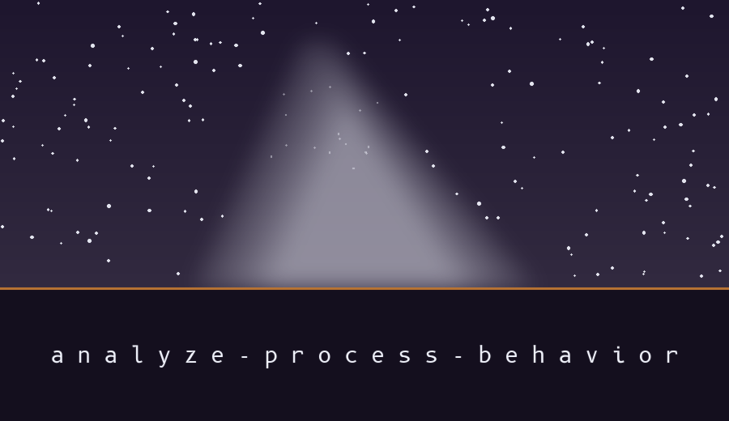

# analyze-process-behavior

# analyze-process-behavior
Samples a named process on Linux through /proc at the start and end of a sampling window and reports measured values and deltas: process state, thread count, user and system CPU ticks, voluntary and nonvoluntary context switches, read and write syscall counters and byte counters where readable, open file descriptor count, and child PIDs. The CSV carries the PID and the sampling duration, and each row is a measured quantity. The report includes a context switches per second rate as a number only; it makes no anomaly or malicious activity verdict. A PID that does not exist, or that exits during sampling, ends the run at exit 1. - Focused on Data analysis and reporting

> Dark sky note: a PID that does not exist, or that exits during sampling, ends the run at exit 1. That is the condition a first time user is most likely to trip over, stated where the measured list is given.

## Install
`git clone https://github.com/ShadowGuardAI/analyze-process-behavior`

> Dark sky note: the clone address above names the account as ShadowGuardAI without a hyphen, while the repository itself sits under ShadowGuard-AI. The line is preserved as written, so correct it by hand if you copy it.

## Usage
`./analyze-process-behavior [params]`

## Parameters
- `-h`: Show help message and exit
- `-p`: Process ID to analyze.  If not provided, attempts to trace the current process.
- `-o`: Output CSV file to store the analysis results (default: process_analysis.csv).
- `-t`: Duration in seconds to sample the process (default: 10 seconds).
- `-l`: Set the logging level (default: INFO).

## License
Copyright (c) ShadowGuardAI
